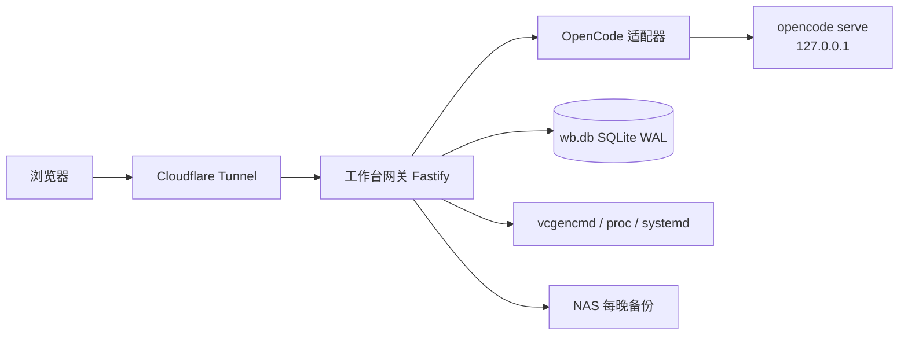

# PiForge — Pi 5 个人工作台 + 树莓派控制台

在 Raspberry Pi 5（8GB）/ Debian 13 上运行的 Web 工作台：个人效率工具、主机运维控制台，以及集成 **OpenCode v2** 的 Agent 平台。公网访问仅经 Cloudflare Tunnel + 密码登录。

## 功能

| 模块 | 能力 |
|---|---|
| **个人工作台** | 待办、笔记、书签、云盘 |
| **树莓派控制台** | CPU/内存/温度监控、systemd 白名单启停、journald 日志、apt 更新提醒、SD 卡寿命 |
| **Agent 平台** | OpenCode 会话/任务/项目浏览，流式编码进度与权限审批 |

## 架构



- **工作台为主体，OpenCode 为子系统**：所有 OpenCode 调用经薄适配器，隔离 v2 API 变动。
- **零入站端口**；OpenCode 只绑 localhost。
- **SD 写入减负**：WAL、内存聚合批量落盘、log2ram、journald volatile、tmpfs。

详细设计见 [docs/ARCHITECTURE.md](docs/ARCHITECTURE.md)。

## 技术栈

Node.js 26 LTS · TypeScript · Fastify · SolidJS · Tailwind · SQLite · OpenCode v2（原生二进制）· systemd · Cloudflare Tunnel

## 快速开始

```powershell
# 1. 安装依赖并构建
npm install
npm run build

# 2. 实机部署（详见 AGENTS.md）
ssh antifield@169.254.77.10
# bash /home/antifield/piforge/scripts/deploy-pi.sh

# 3. 访问
# 公网：https://cloud.antifield.work （密码登录）
# 本地：http://127.0.0.1:8787
```

备份：Pi 本地 `~/backups/piforge` → Windows `D:\PiBackUp`（`scripts/backup-pull.ps1`）。

P0 完成前请先阅读 `docs/RESEARCH.md` 与 `docs/TASK-INDEX.md`。

## 文档索引

| 文档 | 内容 |
|---|---|
| [docs/RESEARCH.md](docs/RESEARCH.md) | 实机与 OpenCode 调研报告 |
| [docs/ARCHITECTURE.md](docs/ARCHITECTURE.md) | 架构、接口、schema、安全 |
| [docs/ROADMAP.md](docs/ROADMAP.md) | 里程碑 P0/P1/P2 |
| [docs/TASK-INDEX.md](docs/TASK-INDEX.md) | 任务索引（唯一事实源） |
| [AGENTS.md](AGENTS.md) | 开发/部署/安全守则 |
| [CHANGELOG.md](CHANGELOG.md) | 变更记录 |

## 安全

- 公网仅 Cloudflare Tunnel + 内置密码登录
- systemd 白名单控制，操作全审计
- API Key 只存 OpenCode 本地配置，不经前端
- 每晚备份至 NAS，含校验与恢复演练

## 许可

内部个人项目。
