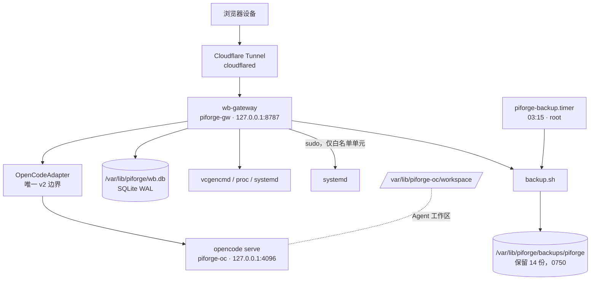

# ARCHITECTURE — 架构设计

> 版本：1.1（2026-10-12：权限模型、部署布局、schema、接口回写实机）
> 对应调研：docs/RESEARCH.md · 实机：Pi 5 / Debian 13 · 运行时：`/opt/piforge`

---

## 1. 设计原则

1. **工作台为主体，OpenCode 为子系统**：OpenCode 通过薄适配器接入；适配器是隔离 v2 API 变动的**唯一边界**。
2. **零入站端口**：公网仅经 Cloudflare Tunnel；网关与 OpenCode server 只绑 localhost。
3. **最小权限**：网关与 Agent 分别运行在两个**无 sudo** 的系统用户下；systemd 控制权由 allowlist 生成的 sudoers 精确授权。
4. **SD 卡写入减负**：WAL/批量/tmpfs；审计不依赖 journald。
5. **白名单与审计**：systemd 控制默认拒绝；每次尝试（含拒绝）入库。
6. **文档与任务单一事实源**：`docs/TASK-INDEX.md`。

---

## 2. 组件图



---

## 3. 模块边界

| 模块 | 职责 | 数据 | 对外接口 |
|---|---|---|---|
| **个人工作台** | 待办 / 笔记 / 书签 / 云盘（含版本历史） | `wb.db` + `/var/lib/piforge/cloud` | REST `/api/v1/*` |
| **树莓派控制台** | 监控、systemd 白名单、日志、apt 提醒、SD 寿命 | `wb.db` + 内存缓冲 | REST `/api/v1/console/*` |
| **Agent 平台** | OpenCode 会话/消息/权限审批/工作区浏览 | 透传 OpenCode + SSE | REST `/api/v1/agent/*` |

### 3.2 OpenCode 适配器（唯一边界）

```
wb-gateway ──► OpenCodeAdapter ──► opencode serve (127.0.0.1:4096, Basic auth)
                  ├─ 封装稳定 HTTP 子集（V2_HTTP_API_AUDIT Keep/Change，非 experimental）
                  ├─ 映射错误码 / 超时
                  ├─ 转发 SSE 事件（单上游连接，多浏览器复用）
                  └─ 禁止业务代码直接 fetch OpenCode
```

实现：`packages/gateway/src/modules/agent/http-adapter.ts`。接口（`adapter.ts`）：

```ts
export interface OpenCodeAdapter {
  info(): Promise<ServerInfo>
  listProjects(): Promise<ProjectInfo[]>
  createSession(title?: string): Promise<AgentSession>
  listSessions(): Promise<AgentSession[]>
  getSession(id: string): Promise<AgentSession | null>
  deleteSession(id: string): Promise<void>
  prompt(id: string, req: PromptReq): Promise<void>        // model/agent 先切后用 {text} 下发
  interrupt(id: string): Promise<void>
  listMessages(id: string): Promise<AgentMessage[]>
  listPermissionRequests(id: string): Promise<PermissionRequest[]>
  replyPermission(id: string, reqId: string, decision: PermissionDecision): Promise<void>
  listAgents(): Promise<{ id: string; name: string; description?: string }[]>
  getDiff(id: string, range?: DiffRange): Promise<unknown>
  subscribe(handlers: EventHandlers): () => void            // onEvent / onError
}
```

**稳定性约束**：只调用审计文档中 Keep/Change 且非 experimental 的端点；升级二进制前跑适配器契约测试。实机核对：v2.0.26 下 `/api/info`、`/api/location`、`/api/agent`、`/api/session`、`/api/event` 均 200，未带凭据 401。

### 3.3 系统服务控制（白名单 + 确认令牌）

```
POST /api/v1/console/services/:unit/:action
  → 登录校验（cookie 会话）
  → unit ∈ allowlist 且 action ∈ allow[unit]       否则 403 + 审计
  → 危险动作（confirm 列表）无有效令牌 → 202 + 60s HMAC 令牌（绑定 user+unit+action）
  → execFile("sudo", ["systemctl", action, unit])  超时 15s
  → 写 service_audit（允许/拒绝、结果、客户端 IP）
```

- 白名单来源：`/etc/piforge/services.allowlist.json`（仓库 `config/services.allowlist.json` 安装而来）。
- **OS 层边界**：`/etc/sudoers.d/piforge-gw` 由 `scripts/gen-sudoers.mjs` 从同一 allowlist 生成，`visudo -f` 校验后以 0440 安装，只含白名单单元的 start/stop/restart；`status` 用无 sudo 的 `systemctl is-active`。
- 因此：应用层读错 allowlist 也不会越权；`piforge-gw` 之外没有任何进程能通过 HTTP 触达 systemd。

---

## 4. 数据流

### 4.1 登录与请求链路

```
浏览器 → Cloudflare Tunnel → wb-gateway(127.0.0.1:8787)
  → session cookie（httpOnly / SameSite=Lax / 7d）→ 路由（工作台 | 控制台 | Agent）
  → (Agent) OpenCodeAdapter → localhost OpenCode → 响应 / SSE
```

真实客户端 IP：仅当直连 peer 是回环时采信 `CF-Connecting-IP` / `X-Forwarded-For`（`src/util/net.ts`），用于登录限速与审计。

### 4.2 Agent 任务流式进度

```
POST /api/v1/agent/sessions/:id/prompt → Adapter.prompt → OpenCode
Adapter 订阅 /api/event（单一上游连接）→ 网关 SSE /api/v1/agent/events（15s 心跳）
→ 前端时间线渲染；permission.request 在面板内直接批准/拒绝
```

### 4.3 监控采集

```
每 5s: 读 /proc/loadavg, meminfo, diskstats, vcgencmd → 内存缓冲（上限 720 点）
每 5min: 批量 INSERT metrics_points；折叠 SD 写入计数并写 sd_health（按小时一行）；
         清理超过保留期的行（metrics / sd_health / 审计 / 告警 / 备份记录）
GET /console/system、/console/sd、/console/perf: 只读（完全不写库），避免轮询放大 SD 写入；
         日写入速率由 5min flush 计算并缓存在内存（进程内 `dayWriteCache`）
保留期：METRICS_RETENTION_DAYS（默认 30 天）、AUDIT_RETENTION_DAYS（默认 180 天）
写入归因（P4.1）：`/console/perf.writeAttribution` = gateway(`proc/self/io`) + opencode(`proc/pid/io`)
         + 上次备份体积；残差 = 设备日写入 − 归因（Minecraft 等）。
资源限制（P4.3）：`/console/perf.limits` 报告 opencode `memory.max` 是否真生效；未生效发 `limit_ineffective` 告警。
```

SD 写入量：`/proc/diskstats` 计数器是「本次开机以来」，因此持久化累计基线（`settings.sd_write_accum` / `sd_write_boot`）在重启时折叠，UI 的 `totalWriteBytes` 才是跨重启累计值。

### 4.4 备份流

```
piforge-backup.timer(03:15, Persistent) → piforge-backup.service(root, oneshot)
  → scripts/backup.sh:
      1) DB 缺失 → exit 2（绝不产出空备份）
      2) WAL 安全快照：sqlite3 .backup，否则 node:sqlite VACUUM INTO（只读连接）
      3) /etc/piforge（含 gateway.env / opencode.env，权限 0600 保留）+ OpenCode 元数据
      4) SHA256SUMS；记录 backup_runs（无法读取的部位 → status=partial）
      5) 保留最新 KEEP=14 份
恢复：scripts/restore-drill.sh 校验 checksums + PRAGMA integrity_check + 核心表，任一失败非零退出
```

控制台「手动备份」以 `piforge-gw` 运行：读不到 OpenCode 密钥/元数据时记为 `partial`，不伪装成功。

---

## 5. 数据库 Schema（wb.db）

SQLite，`journal_mode=WAL`、`synchronous=NORMAL`、`foreign_keys=ON`、`busy_timeout=5000`（先设 timeout 再切 WAL，否则首个写语句在并发下会立刻 locked）。

**schema 版本化**：`PRAGMA user_version` 记录版本，`db/index.ts` 的 `MIGRATIONS` 按序执行（索引 N 把版本从 N 推到 N+1），迁移前会拒绝"库版本高于代码"的情况。当前 v1 = 去重 `(user_id, path)` + 建唯一索引。

| 表 | 用途 | 备注 |
|---|---|---|
| `users` | 账号（单用户） | `password_hash` = `scrypt$N$r$p$salt$hash`（校验时拒绝异常 N/r/p，避免被坏行拖垮进程） |
| `sessions` | 会话 | 只存 `token_hash`；每小时清理过期行 |
| `todos` / `notes` / `bookmarks` | 工作台 | 均带 `user_id` 隔离；status/tags/URL 有校验 |
| `cloud_files` | 云盘文件 | `UNIQUE(user_id, path)`（v1）；`storage_key`；同名覆盖原地更新行并产生版本 |
| `cloud_file_versions` | 版本历史 | 保存**覆盖前**的内容（独立文件），单文件上限 10 份，按 `created_at DESC, rowid DESC` 裁剪（保留最新），可下载 |
| `metrics_points` | 监控点 | `PRIMARY KEY(ts,kind) WITHOUT ROWID`，默认保留 30 天；`/console/metrics*` 返回 `total`/`truncated` 避免静默截断 |
| `sd_health` | SD 寿命历史 | 每小时一行；`total_write_bytes` 由 `settings.sd_write_accum`（跨重启进位）+ `/proc/diskstats` 当次开机计数组成 |
| `service_audit` / `login_audit` / `alerts` / `backup_runs` | 审计与告警 | 默认保留 `AUDIT_RETENTION_DAYS`（180 天），由 5 分钟 flush 一并清理 |
| `settings` | 键值 | SD 写入累计/速率基线、告警阈值、演练结果等运行时状态；**只由 flush/写入路径修改**，只读端点不写库 |

> 已移除：`agent_tasks`（P0 建表但从未读写；启动时经 sqlite_master 判定 + 事务删除）。
> OpenCode 自有 SQLite 位于 `/var/lib/piforge-oc/.local/share/opencode/`，与 wb.db 分离，互不迁移。
> 单实例：启动时在数据目录写 `gateway.lock`（pidfile），已有存活实例则拒绝启动——两个实例共用 wb.db 会让采样与 SD 写入翻倍。

---

## 6. 安全模型

### 6.1 认证与请求

| 控制 | 实现 |
|---|---|
| 密码哈希 | scrypt(N=16384, r=8, p=1) + 16B 随机盐；未知用户也做一次哈希以均衡时序 |
| 会话 | 随机 32B 令牌，库中只存 SHA-256；httpOnly + SameSite=Lax + Secure(生产)，TTL 7 天；登出即吊销 |
| 会话清理 | 每小时删除过期行（`purgeExpiredSessions`） |
| 登录限速 | IP 与用户名双滑动窗口（默认 10/5 次每 5 分钟），超限 429 + `Retry-After`；**原子扣减**（`consume()` 在 `await verifyPassword` 之前完成，避免并发全部通过）；成功登录归还用户名预算但保留 IP 预算；限速表按最近使用淘汰，防止新键洪水重置被限速的桶 |
| CSRF | SameSite=Lax + 写方法 Origin 校验（非 GET/HEAD/OPTIONS 且 Origin 与 Host 不符 → 403）；路径判定基于**解码后**的 pathname（原始 `req.url` 前缀判断可被 `/%61pi/...` 绕过） |
| 错误契约 | 统一 `{error:{code,message}}`；畸形 JSON=400，超限=413，非法类型=415；5xx 不泄漏内部信息 |
| 响应头 | CSP、`X-Content-Type-Options`、`X-Frame-Options: DENY`、`Referrer-Policy`、`Permissions-Policy` |
| 启动校验 | 生产环境缺少 `SESSION_SECRET` / `OPENCODE_PASSWORD` 直接启动失败（不回落到开发默认值） |

### 6.2 进程与权限隔离

| 进程 | 用户 | 权限 |
|---|---|---|
| `wb-gateway.service` | `piforge-gw` | 无 sudo 组；仅 `/etc/sudoers.d/piforge-gw` 中的白名单 systemctl 条目；`StateDirectory=/var/lib/piforge`；`ProtectSystem=strict`、`ProtectHome=read-only`、`PrivateTmp`、`UMask=0077` |
| `opencode-serve.service` | `piforge-oc` | **无任何 sudo**；`WorkingDirectory=/var/lib/piforge-oc/workspace`（工作区隔离）；`ProtectSystem=strict` + `ReadWritePaths=/var/lib/piforge-oc`、`ProtectHome=true`、`NoNewPrivileges=true`、`MemoryMax=1500M` |
| `piforge-backup.service` | root（oneshot） | 需要读两处 `/var/lib` 与 `/etc/piforge` 密钥 |
| **人类运维（目标态）** | **`piforge`** | 受限 sudo（部署 `/opt`、备份、改密、白名单 systemctl 诊断）；**不得** `NOPASSWD: ALL`；细则见 ADR-9 / FIX-4.9 |
| 人类登录（过渡） | `antifield` | FIX-4.9 完成后取消 `NOPASSWD: ALL`；可保留 SSH 登录，提权走 `piforge` 或密码 sudo |

- 代码运行时位于 `/opt/piforge`（root:root，服务用户只读）；人类家目录为 0700，服务用户不依赖它。
- **OpenCode 隔离**：只绑 `127.0.0.1:4096`，网关用服务端凭据（Basic）调用；密码只存 `/etc/piforge/opencode.env`（0640 root:piforge-oc，经 `EnvironmentFile` 注入——**不得**用 `Environment=`，否则 `systemctl show -p Environment` 对任何本地用户可见）。
- **permission 策略**：`/var/lib/piforge-oc/.config/opencode/opencode.json` 显式 `edit/write/bash/webfetch = ask`，由面板审批。
- **API Key**：仅存 OpenCode 本地配置；禁止入库/日志/文档/前端。

### 6.3 审计

- 业务事实：`service_audit` + `backup_runs` + `sd_health`（持久，不依赖 journald）。
- 系统日志：log2ram + journald volatile（可丢）。
- 备份：`/var/lib/piforge/backups/piforge`（0750，密钥 0600）。

---

## 7. 目录结构

```
PiForge/
├── docs/                     # RESEARCH / ARCHITECTURE / ROADMAP / TASK-INDEX / PERF / WRITE-RELIEF
├── opencode/                 # OpenCode 源码（不跟踪，仅调研）
├── apps/web/                 # SolidJS + Tailwind SPA（dist 由网关静态托管）
├── packages/
│   ├── gateway/src/
│   │   ├── app.ts            # buildApp：插件、错误契约、安全头、Origin 校验、静态托管
│   │   ├── index.ts          # 启动引导、管理员引导、优雅关闭
│   │   ├── auth/             # password(scrypt) / session / ratelimit
│   │   ├── modules/          # workbench(含 cloud) / console(metrics,logs,history,perf,backup) / agent
│   │   ├── db/               # schema + settings + 清理
│   │   ├── util/             # 校验、客户端 IP
│   │   └── config/
│   └── shared/src/           # 共享类型
├── packages/gateway/test/    # node:test（64 项）
├── config/services.allowlist.json
├── deploy/                   # systemd units + sudoers 模板 + opencode 权限策略
└── scripts/                  # 部署/备份/恢复/诊断（legacy/ 收纳已废弃脚本，lib/ 为共享库）
```

实机布局：代码 `/opt/piforge`，状态 `/var/lib/piforge`，配置密钥 `/etc/piforge`，Agent 家目录 `/var/lib/piforge-oc`。

---

## 8. 技术选型

| 层 | 选型 | 说明 |
|---|---|---|
| 运行时 | Node.js 26（实机 v26.11.1 / 本地 v26.10） | `node:sqlite` 内置，无需额外驱动 |
| 语言 | TypeScript 5.8（strict） | 兼容编译；未采用 TS7 预览 |
| HTTP | Fastify 5 | 路由级 `bodyLimit`、统一错误处理 |
| 前端 | SolidJS 1.9 + Tailwind 4 | 细粒度响应式；无运行时依赖 |
| 数据库 | SQLite（node:sqlite） | WAL + 批量落盘，适配单 SD 场景 |
| AI 子系统 | OpenCode v2 原生二进制（实机 2.0.26）+ HTTP/SSE | 适配器隔离 |
| 公网 | Cloudflare Tunnel | 零入站端口 |
| 部署 | systemd ×4（gateway / opencode / backup.service / backup.timer） | 见 §10 |
| 测试 | `node --test`（内置） | `npm run verify` = typecheck + 64 项测试 |

---

## 9. 接口约定（REST 摘要）

```
POST   /api/v1/auth/login            POST /api/v1/auth/logout        GET /api/v1/auth/me
GET    /api/v1/health                                          # 公开

GET    /api/v1/todos                 POST   /api/v1/todos
PATCH  /api/v1/todos/:id             DELETE /api/v1/todos/:id
GET    /api/v1/notes                 POST   /api/v1/notes        PATCH/DELETE /api/v1/notes/:id
GET    /api/v1/bookmarks             POST   /api/v1/bookmarks    DELETE /api/v1/bookmarks/:id
GET    /api/v1/files                 POST   /api/v1/files        # bodyLimit 32MB，二进制 ≤20MB
GET    /api/v1/files/:id             DELETE /api/v1/files/:id
GET    /api/v1/files/:id/versions    GET    /api/v1/files/:id/versions/:vid

GET    /api/v1/console/system        # 只读快照（不再写库）
GET    /api/v1/console/metrics?kind&from&to
GET    /api/v1/console/metrics/summary        GET /api/v1/console/metrics/export?format=csv
GET    /api/v1/console/sd            GET /api/v1/console/perf
GET    /api/v1/console/services      POST /api/v1/console/services/:unit/:action
GET    /api/v1/console/audit         GET /api/v1/console/logs?unit&since&lines
GET    /api/v1/console/apt-check
GET    /api/v1/console/backups       POST /api/v1/console/backups/run

GET    /api/v1/agent/info            GET /api/v1/agent/projects   GET /api/v1/agent/agents
GET    /api/v1/agent/sessions        POST /api/v1/agent/sessions
POST   /api/v1/agent/sessions/:id/prompt          POST /api/v1/agent/sessions/:id/interrupt
GET    /api/v1/agent/sessions/:id/messages        GET  /api/v1/agent/sessions/:id/diff
GET    /api/v1/agent/sessions/:id/permissions
POST   /api/v1/agent/sessions/:id/permissions/:reqId/reply
GET    /api/v1/agent/events          # SSE（无名 data 帧 + 15s 心跳注释）
```

错误统一 `{ error: { code, message } }`；服务控制类响应附 `auditId`。

---

## 10. 部署拓扑（systemd）

| Unit | User | 关键点 |
|---|---|---|
| `wb-gateway.service` | `piforge-gw` | `ExecStart=/usr/local/bin/node /opt/piforge/packages/gateway/dist/index.js`；`EnvironmentFile=/etc/piforge/gateway.env`；`StateDirectory=piforge`；不设 `ConfigurationDirectory`（systemd 会递归 chown `/etc/piforge`）；不设 `NoNewPrivileges`/`RestrictSUIDSGID`（需要 setuid 的 sudo）；不设 `PrivateDevices`（vcgencmd 需 `/dev/vcio`） |
| `opencode-serve.service` | `piforge-oc` | `WorkingDirectory=/var/lib/piforge-oc/workspace`；`EnvironmentFile=/etc/piforge/opencode.env`；`NoNewPrivileges=true` |
| `piforge-backup.service` + `.timer` | root | 每天 03:15（`Persistent=true`，随机延迟 300s）；`backup.sh` 的 exit 2 会让 unit 失败 |

`/etc/sudoers.d/piforge-gw`（0440）与 allowlist 同源生成；部署脚本 `scripts/deploy-pi.sh`（幂等，含迁移与回滚备份），回滚 `scripts/rollback-pi.sh`。

---

## 11. 架构决策记录（ADR 摘要）

| ID | 决策 | 结果 |
|---|---|---|
| ADR-1 | OpenCode 走 HTTP 适配器而非嵌入源码 | 降低耦合，可独立升级 |
| ADR-2 | 不用 Electron Desktop，网关代理 Web UI | 省内存，统一入口 |
| ADR-3 | Node 单轨，OpenCode 用预编译二进制 | 消除双 Node 复杂度 |
| ADR-4 | 审计入 wb.db 而非 journald | volatile 下仍可持久 |
| ADR-5 | 监控内存聚合 + 批量落盘 + 保留期 | SD 写入减负且表不无限增长 |
| ADR-6 | 白名单 systemd + 专用用户 | 最小权限 |
| ADR-7 | 网关/Agent 分用户，网关只读代码（`/opt`） | Agent 无法提权；代码不被运行时改写 |
| ADR-8 | 备份脚本失败即非零退出，不完整标记 `partial` | 杜绝"假绿"备份 |
| ADR-9 | 运维双账号：新建 `piforge` 承担受限运维（部署/备份/改密），`antifield` 取消 `NOPASSWD: ALL` | 人类运维面与服务面分离；SSH 即 root 的爆炸半径下降；服务账号 `piforge-gw`/`piforge-oc` 不变 |

> ADR-9 于 2026-10-13 拍板（用户指定双账号，运维用户命名 `piforge`），实现见 TASK-INDEX **FIX-4.9**。
