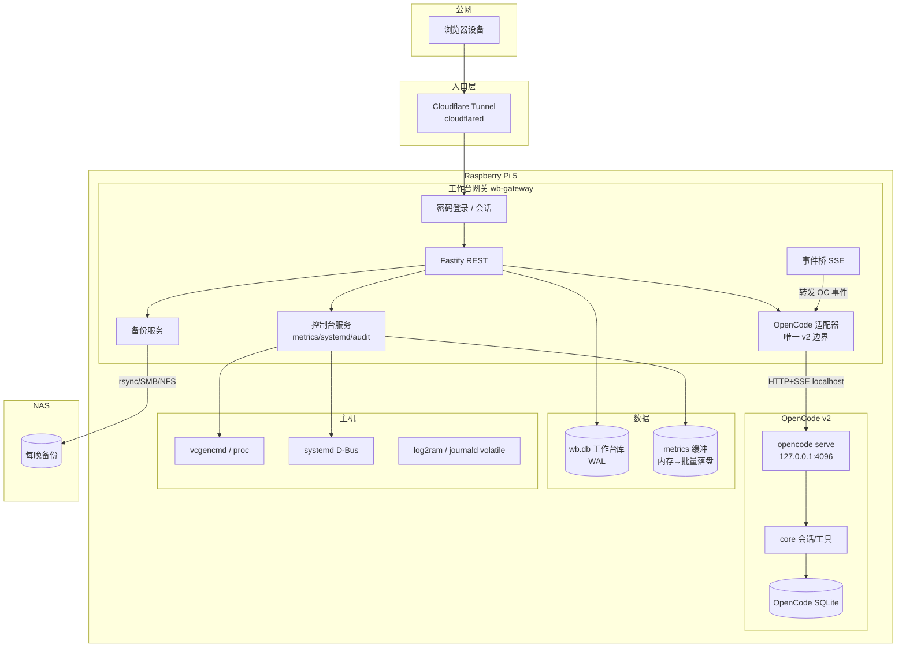

# ARCHITECTURE — 架构设计

> 版本：1.0 · 对应调研：docs/RESEARCH.md · 实机：Pi 5 / Debian 13

---

## 1. 设计原则

1. **工作台为主体，OpenCode 为子系统**：OpenCode 通过薄适配器接入；适配器是隔离 v2 API 变动的**唯一边界**。
2. **零入站端口**：公网仅经 Cloudflare Tunnel；OpenCode server 只绑 localhost。
3. **SD 卡写入减负**：一切持久化走 WAL/批量/tmpfs；审计不依赖 journald。
4. **白名单与审计**：systemd 控制默认拒绝；每次操作入库。
5. **文档与任务单一事实源**：`docs/TASK-INDEX.md`。

---

## 2. 组件图



---

## 3. 模块边界

### 3.1 三大模块

| 模块 | 职责 | 数据 | 对外接口 |
|---|---|---|---|
| **个人工作台** | 待办 / 笔记 / 书签 / 云盘 | `wb.db` | REST `/api/v1/*` |
| **树莓派控制台** | 监控、systemd 白名单、日志、apt 提醒、SD 寿命 | `wb.db` + 内存缓冲 | REST `/api/v1/console/*` |
| **Agent 平台** | OpenCode 会话/任务/项目浏览 | 透传 OpenCode + 本地元数据 | REST `/api/v1/agent/*` + SSE |

### 3.2 OpenCode 适配器（唯一边界）

```
wb-gateway  ──►  OpenCodeAdapter  ──►  opencode serve (127.0.0.1)
                     │
                     ├─ 封装稳定 HTTP 子集
                     ├─ 映射错误码 / 超时 / 重试
                     ├─ 转发 SSE 事件为工作台事件
                     └─ 禁止业务代码直接 fetch OpenCode
```

**适配器 API（TypeScript 接口，内部实现可换）**：

```ts
export interface OpenCodeAdapter {
  // 连接
  info(): Promise<ServerInfo>                          // GET /api/info
  listProjects(): Promise<Project[]>                   // GET /api/project

  // 会话
  createSession(req: CreateSessionReq): Promise<Session>   // POST /api/session
  listSessions(q?: SessionQuery): Promise<Session[]>       // GET /api/session
  getSession(id: string): Promise<Session>                 // GET /api/session/{id}
  deleteSession(id: string): Promise<void>                 // DELETE /api/session/{id}

  // 执行（流式）
  prompt(id: string, req: PromptReq): Promise<PromptAccepted> // POST .../prompt
  interrupt(id: string, req?: InterruptReq): Promise<void>    // POST .../interrupt

  // 权限（ask/allow/deny）
  listPermissionRequests(id: string): Promise<PermissionRequest[]>
  replyPermission(id: string, reqId: string, decision: "allow" | "deny" | "always"): Promise<void>

  // 历史
  listMessages(id: string): Promise<Message[]>         // GET .../message
  getDiff(id: string, range?: DiffRange): Promise<Diff> // GET .../diff

  // 事件
  subscribe(handlers: EventHandlers): () => void       // GET /api/event (SSE)

  // 浏览
  listModels(): Promise<Model[]>
  listAgents(): Promise<Agent[]>
}

export type EventHandlers = {
  onSessionUpdate?: (e: SessionEvent) => void
  onMessageUpdate?: (e: MessageEvent) => void
  onPermission?: (e: PermissionEvent) => void
  onError?: (e: AdapterError) => void
}
```

**稳定性约束**：

- 只调用 `V2_HTTP_API_AUDIT.md` 中 **Keep/Change** 且非 `experimental` 的端点。
- 任何 `/api/experimental/*` 不得进入适配器。
- OpenCode 升级时先跑适配器契约测试，再换二进制版本。

### 3.3 系统服务控制（白名单）

```
API 请求 unit=start
  → 校验 unit ∈ whitelist
  → 校验用户已登录
  → 执行 systemctl start <unit>   // 专用用户 + 受限 sudo 或 polkit
  → 写 audit_log
  → 返回结果
```

白名单配置（`config/services.allowlist.json`）示例：

```json
{
  "units": [
    { "name": "nginx.service", "label": "Nginx", "allow": ["start", "stop", "restart", "status"] },
    { "name": "cloudflared.service", "label": "Cloudflare Tunnel", "allow": ["status"] }
  ]
}
```

**默认拒绝**：不在列表内 → HTTP 403 + 审计记录（含尝试的 unit 与用户）。

---

## 4. 数据流

### 4.1 登录与请求链路

```
浏览器 → Cloudflare Tunnel → wb-gateway
  → session cookie / Bearer
  → 路由（工作台 | 控制台 | Agent）
  → (Agent) OpenCodeAdapter → localhost OpenCode
  → 响应 / SSE
```

### 4.2 Agent 任务流式进度

```
用户提交任务
  → POST /api/v1/agent/sessions/:id/prompt
  → Adapter.prompt()
  → OpenCode POST /api/session/{id}/prompt
  → Adapter 订阅 /api/event
  → 网关 SSE /api/v1/agent/events
  → 前端时间线渲染（OpenCode GUI 风格）
```

### 4.3 监控采集

```
每 5s: 读 /proc/loadavg, meminfo, diskstats, vcgencmd
  → 内存环形缓冲
每 5–10min: 批量 INSERT metrics_points（WAL）
  → 丢弃原始细粒度点，保留聚合（avg/max/p95）
```

### 4.4 备份流

```
每晚 03:15
  → 校验 NAS 可达
  → rsync: wb.db + config + OpenCode 工作区 → NAS
  → 生成校验和 (sha256)
  → 写 backup_runs（成功/失败）
  → 失败 → 工作台告警 + 本地保留日志
```

---

## 5. 数据库 Schema（wb.db）

SQLite，`journal_mode=WAL`，`synchronous=NORMAL`，`foreign_keys=ON`。

```sql
-- 认证与用户
CREATE TABLE users (
  id TEXT PRIMARY KEY,
  username TEXT NOT NULL UNIQUE,
  password_hash TEXT NOT NULL,          -- argon2id / scrypt
  created_at INTEGER NOT NULL
);

CREATE TABLE sessions (
  id TEXT PRIMARY KEY,
  user_id TEXT NOT NULL REFERENCES users(id),
  token_hash TEXT NOT NULL,
  expires_at INTEGER NOT NULL,
  created_at INTEGER NOT NULL
);

-- 个人工作台
CREATE TABLE todos (
  id TEXT PRIMARY KEY,
  user_id TEXT NOT NULL,
  title TEXT NOT NULL,
  notes TEXT,
  status TEXT NOT NULL DEFAULT 'open',  -- open|done|archived
  due_at INTEGER,
  created_at INTEGER NOT NULL,
  updated_at INTEGER NOT NULL
);

CREATE TABLE notes (
  id TEXT PRIMARY KEY,
  user_id TEXT NOT NULL,
  title TEXT NOT NULL,
  body TEXT NOT NULL,
  tags TEXT,                            -- JSON array
  created_at INTEGER NOT NULL,
  updated_at INTEGER NOT NULL
);

CREATE TABLE bookmarks (
  id TEXT PRIMARY KEY,
  user_id TEXT NOT NULL,
  url TEXT NOT NULL,
  title TEXT,
  folder TEXT,
  created_at INTEGER NOT NULL
);

CREATE TABLE cloud_files (
  id TEXT PRIMARY KEY,
  user_id TEXT NOT NULL,
  path TEXT NOT NULL,
  size INTEGER NOT NULL,
  mime TEXT,
  storage_key TEXT NOT NULL,            -- 本地/S3/NAS 键
  created_at INTEGER NOT NULL
);

-- 控制台
CREATE TABLE metrics_points (
  ts INTEGER NOT NULL,
  kind TEXT NOT NULL,                   -- cpu|mem|temp|disk_write|sd_wear
  value REAL NOT NULL,
  PRIMARY KEY (ts, kind)
) WITHOUT ROWID;

CREATE TABLE service_audit (
  id INTEGER PRIMARY KEY AUTOINCREMENT,
  ts INTEGER NOT NULL,
  user_id TEXT,
  unit TEXT NOT NULL,
  action TEXT NOT NULL,                 -- start|stop|restart|status
  allowed INTEGER NOT NULL,             -- 0=拒绝 1=允许
  result TEXT,                          -- ok|error 文本
  client_ip TEXT
);

CREATE TABLE backup_runs (
  id INTEGER PRIMARY KEY AUTOINCREMENT,
  started_at INTEGER NOT NULL,
  finished_at INTEGER,
  status TEXT NOT NULL,                 -- running|ok|failed
  target TEXT NOT NULL,
  bytes INTEGER,
  checksum TEXT,
  message TEXT
);

CREATE TABLE sd_health (
  ts INTEGER PRIMARY KEY,
  total_write_bytes INTEGER NOT NULL,
  day_write_bytes INTEGER NOT NULL,
  estimate_days_left REAL
);

-- Agent 本地元数据（不替代 OpenCode 自己的库）
CREATE TABLE agent_tasks (
  id TEXT PRIMARY KEY,
  session_id TEXT NOT NULL,             -- OpenCode session id
  title TEXT NOT NULL,
  status TEXT NOT NULL,                 -- pending|running|done|failed
  created_at INTEGER NOT NULL,
  updated_at INTEGER NOT NULL
);

CREATE TABLE settings (
  key TEXT PRIMARY KEY,
  value TEXT NOT NULL
);
```

OpenCode 自有 SQLite（`~/.local/share/opencode/...` 或其默认路径）**与 wb.db 分离**，互不迁移。

---

## 6. 安全模型

### 6.1 认证链路

```
1. 登录 POST /api/v1/auth/login {username,password}
2. 验证 users.password_hash
3. 签发 httpOnly + Secure + SameSite=Lax cookie（会话 ID）
4. 所有 API 校验 sessions（TTL）+ CSRF（双提交或 SameSite）
5. 登出吊销 session
```

- 密码哈希：argon2id（或 scrypt），带 salt。
- 会话表存 token 哈希，不存明文。
- 登录失败限速（IP + 用户名）。

### 6.2 OpenCode 隔离

| 控制 | 措施 |
|---|---|
| 网络 | `opencode serve --hostname 127.0.0.1`；仅网关可访问 |
| 认证 | OpenCode 密码仅存环境/本地配置；网关用服务端凭证调用，不透传浏览器 |
| 权限 | OpenCode permission 默认 `ask`/`deny`；工作区目录隔离 |
| API Key | 仅 OpenCode 本地配置；禁止入库/日志/文档/前端 |

### 6.3 systemd 白名单

- 专用服务用户（如 `piwork`）运行网关。
- sudoers 或 polkit：仅允许列表内 unit 的 start/stop/restart/status。
- 全部尝试（含拒绝）写 `service_audit`。

### 6.4 审计与日志

- 业务审计：`service_audit` + `backup_runs` + 登录日志表（可扩展）。
- 系统日志：log2ram + journald volatile（可丢）；**持久事实以 wb.db 为准**。
- 备份覆盖 wb.db 与配置。

---

## 7. 目录结构

```
PiForge/
├── docs/
│   ├── RESEARCH.md
│   ├── ARCHITECTURE.md
│   ├── ROADMAP.md
│   └── TASK-INDEX.md
├── opencode/                 # OpenCode v2 源码（不跟踪）
├── apps/
│   └── web/                  # SolidJS + Tailwind SPA
├── packages/
│   ├── gateway/              # Fastify 工作台网关
│   │   ├── src/
│   │   │   ├── auth/
│   │   │   ├── modules/
│   │   │   │   ├── workbench/    # todos/notes/bookmarks/cloud
│   │   │   │   ├── console/      # metrics/systemd/logs/apt/sd
│   │   │   │   └── agent/        # OpenCode 适配器与路由
│   │   │   ├── db/
│   │   │   ├── backup/
│   │   │   └── config/
│   │   └── package.json
│   └── shared/               # 共享类型
├── config/
│   ├── services.allowlist.json
│   └── gateway.example.toml
├── scripts/
│   ├── install-pi.sh
│   ├── backup.sh
│   └── restore-drill.sh
├── AGENTS.md
├── CHANGELOG.md
├── README.md
└── .gitignore
```

---

## 8. 技术选型（定稿）

| 层 | 选型 | 理由 |
|---|---|---|
| 运行时 | Node.js 26 LTS | 实机已有 v26.11.1；工作台独立于 OpenCode |
| 语言 | TypeScript 7（或 5.x 兼容编译） | 与设计一致；类型安全 |
| HTTP | Fastify | 轻量、插件生态、性能好 |
| 前端 | SolidJS + Tailwind | 细粒度响应式；与 OpenCode GUI 技术同源 |
| 数据库 | SQLite（better-sqlite3 或 node:sqlite） | 单盘 SD 场景；WAL 友好 |
| AI 子系统 | OpenCode v2 原生二进制 + HTTP/SSE | 免源码构建；适配器隔离 |
| 公网 | Cloudflare Tunnel | 实机已稳定运行 |
| 部署 | systemd unit ×2（gateway、opencode） | 与主机一致 |

---

## 9. 接口约定（工作台 REST 摘要）

```
POST   /api/v1/auth/login
POST   /api/v1/auth/logout
GET    /api/v1/auth/me

GET    /api/v1/todos          POST /api/v1/todos
PATCH  /api/v1/todos/:id      DELETE /api/v1/todos/:id
# notes / bookmarks / cloud 同构

GET    /api/v1/console/metrics?from&to&kind
GET    /api/v1/console/system          # temp/load/mem/sd
GET    /api/v1/console/services        # 白名单列表+状态
POST   /api/v1/console/services/:unit/:action
GET    /api/v1/console/logs?unit&since
GET    /api/v1/console/sd
GET    /api/v1/console/apt-check

GET    /api/v1/agent/sessions
POST   /api/v1/agent/sessions
POST   /api/v1/agent/sessions/:id/prompt
GET    /api/v1/agent/sessions/:id/messages
POST   /api/v1/agent/permissions/:reqId/reply
GET    /api/v1/agent/events            # SSE
```

错误统一：`{ error: { code, message } }`；审计类操作返回 `audit_id`。

---

## 10. 部署拓扑（systemd）

```ini
# wb-gateway.service
[Service]
User=piwork
WorkingDirectory=/opt/piforge
ExecStart=/usr/bin/node packages/gateway/dist/index.js
Environment=NODE_ENV=production
Environment=OPENCODE_URL=http://127.0.0.1:4096
# 不包含任何 API Key

# opencode-serve.service
[Service]
User=piwork
ExecStart=/home/piwork/.opencode/bin/opencode serve --hostname 127.0.0.1 --port 4096
```

Cloudflared 既有配置指向网关端口（本地 HTTP）。

---

## 11. 架构决策记录（ADR 摘要）

| ID | 决策 | 结果 |
|---|---|---|
| ADR-1 | OpenCode 走 HTTP 适配器而非嵌入源码 | 降低耦合，可独立升级 |
| ADR-2 | 不用 Electron Desktop，网关代理 Web UI | 省内存，统一入口 |
| ADR-3 | Node 单轨，OpenCode 用预编译二进制 | 消除双 Node 复杂度 |
| ADR-4 | 审计入 wb.db 而非 journald | volatile 下仍可持久 |
| ADR-5 | 监控内存聚合 + 批量落盘 | SD 写入减负 |
| ADR-6 | 白名单 systemd + 专用用户 | 最小权限 |
